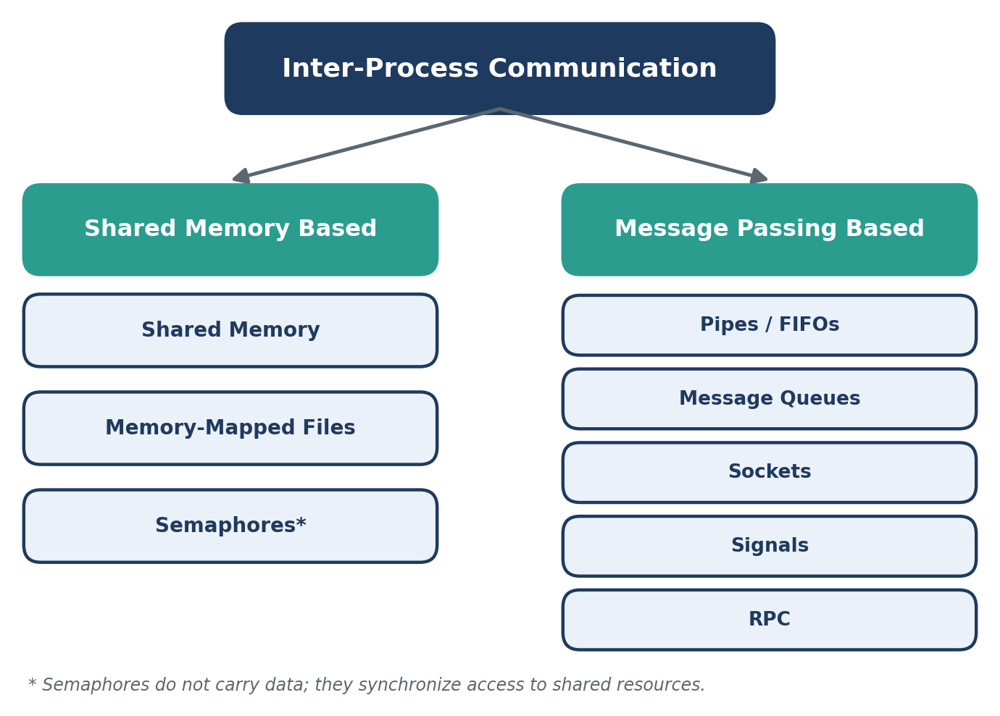
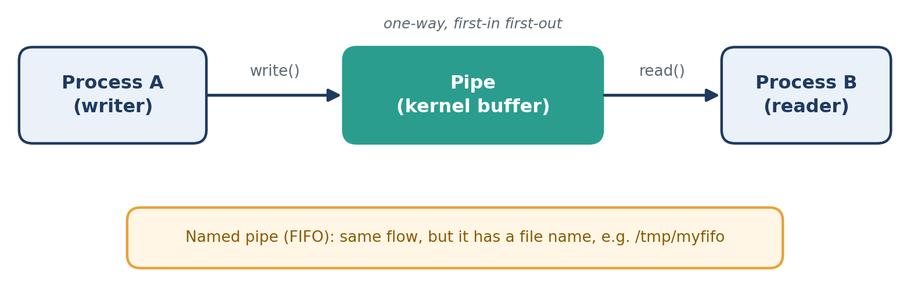
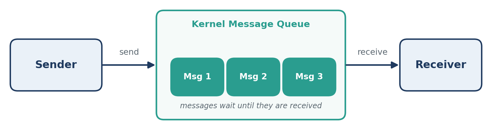
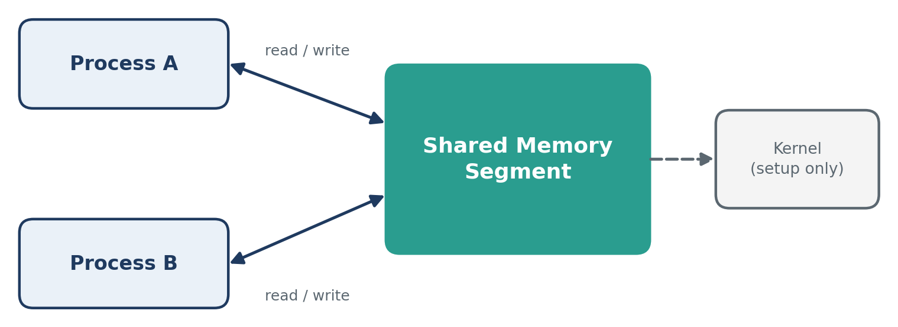
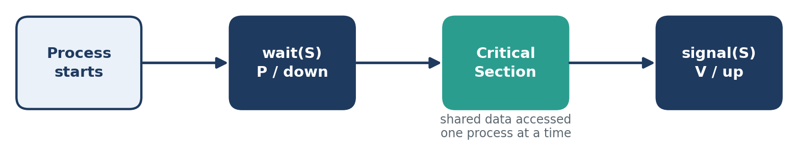
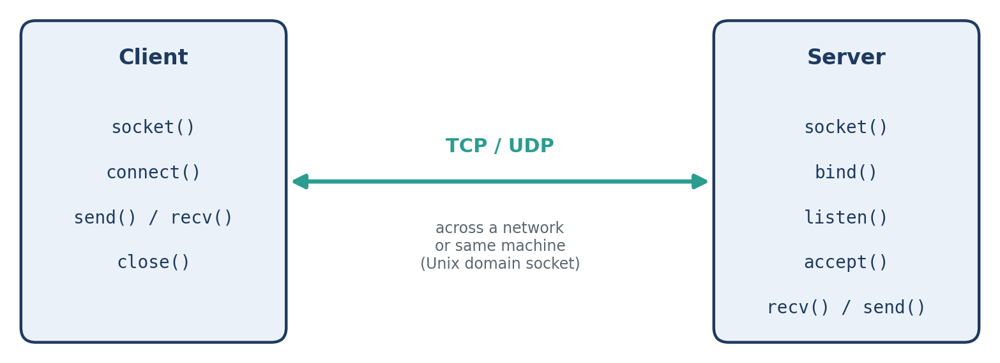
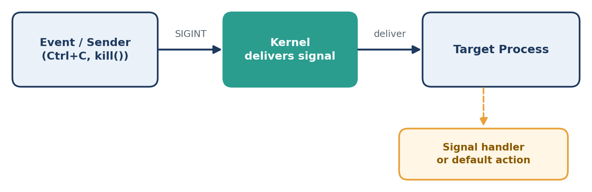
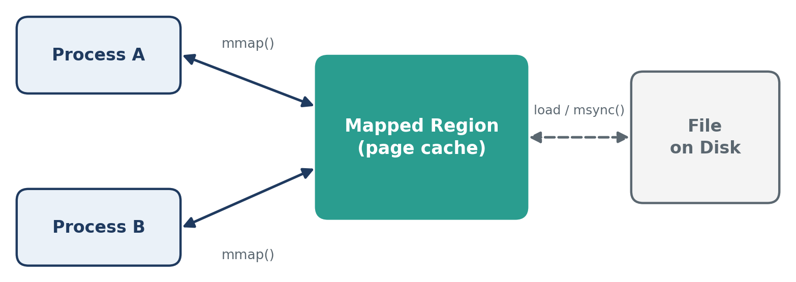
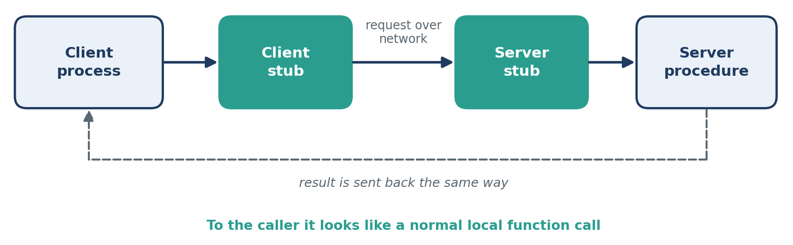

# Operating Systems: Inter-Process Communication (IPC)

**Course:** Operating Systems  
**Project:** Inter-Process Communication (IPC)  
**Team:** CodeX  

### Team Members

| Member Name | Contribution Focus |
|---|---|
| **Disha** | IPC Comprehensive Overview, Architecture & Report Compilation |
| **Dhanush** | Pipes and Message Queues |
| **Sohan** | Shared Memory and Semaphores |
| **Bathin** | Sockets and Signals |

---

## Table of Contents

- [1. Definition](#1-definition)
- [2. Why IPC Is Needed](#2-why-ipc-is-needed)
- [3. IPC Techniques](#3-ipc-techniques)
  - [3.1 Pipes](#31-pipes)
  - [3.2 Message Queues](#32-message-queues)
  - [3.3 Shared Memory](#33-shared-memory)
  - [3.4 Semaphores](#34-semaphores)
  - [3.5 Sockets](#35-sockets)
  - [3.6 Signals](#36-signals)
  - [3.7 Memory-Mapped Files](#37-memory-mapped-files)
  - [3.8 Remote Procedure Calls (RPC)](#38-remote-procedure-calls-rpc)
- [4. IPC Techniques at a Glance](#4-ipc-techniques-at-a-glance)
- [5. Conclusion](#5-conclusion)

---

## 1. Definition

**Inter-Process Communication (IPC)** is a set of tools and methods that the operating system offers to let different processes share data and coordinate their activities. 

Each process runs in its own private memory space, so one process cannot directly access or change the memory of another. That is why IPC is needed: it creates controlled ways for processes to talk to each other.

---

## 2. Why IPC Is Needed

Operating systems rely on IPC for several critical purposes:

- **Information Sharing:** Many processes may need the same information at the same time.
- **Computation Speed-up:** A big job can be broken into parts and run concurrently in different processes.
- **Modularity:** A complex system can be split into smaller, easier-to-manage parts that work together.
- **Convenience:** Users can run related tasks together, for example by linking commands using pipelines.

---

## 3. IPC Techniques

IPC techniques fall into two broad categories: **shared memory** and **message passing**. Shared memory lets processes access a common memory region, while message passing sends data through the kernel.

  
*Figure 1: Classification of IPC techniques*

---

### 3.1 Pipes

A **pipe** is a one-way communication channel maintained by the kernel. The output of one process is fed directly as the input of another, which is how shell pipelines such as `ls | grep foo` work.

  
*Figure 2: A pipe carrying data from a writer to a reader*

#### Types

- **Unnamed (Anonymous) Pipes:** One-way byte streams, typically used between a parent and a child process (for example, `ls | grep foo`).
- **Named Pipes (FIFOs):** Have a name in the file system, which allows unrelated processes to communicate.

#### How It Works

1. The pipe is created (`pipe()` for unnamed, `mkfifo()` for named), providing a read end and a write end.
2. The writer process writes bytes to the write end.
3. The kernel stores the bytes in a buffer in first-in, first-out (FIFO) order.
4. The reader process reads the bytes from the read end.
5. If the buffer is empty the reader waits, and if it is full the writer waits.

#### Advantages

- Simple and easy to use.
- Built directly into the shell (pipelines).
- Kernel handles the waiting automatically, so little extra synchronization is needed.

#### Disadvantages

- Data flows in one direction only (two pipes are required for bidirectional communication).
- Limited buffer size.
- Unnamed pipes work only between related processes with a common ancestor.
- No message boundaries; it is strictly a stream of bytes.
- Works only on the same machine.

---

### 3.2 Message Queues

A **message queue** is a list of messages maintained by the kernel. A process can post a message to the queue and another process can pick it up later, so the two do not have to run at the same time. Messages can be assigned priorities, and both POSIX and System V provide message queue implementations.

  
*Figure 3: Sender and receiver communicating through a kernel message queue*

#### How It Works

1. Create or open a queue (`msgget()` in System V, `mq_open()` in POSIX).
2. The sender adds a message with a type or priority (`msgsnd()` / `mq_send()`).
3. The kernel stores the message until it is received.
4. The receiver takes a message from the queue (`msgrcv()` / `mq_receive()`), selected by priority or type.
5. Remove the queue when finished (`msgctl()` / `mq_unlink()`).

#### Advantages

- **Asynchronous:** Sender and receiver do not need to run concurrently.
- Message boundaries are strictly preserved.
- Messages can be prioritized according to type or importance.
- Works between completely unrelated processes.

#### Disadvantages

- Limits on individual message size and maximum queue length.
- Data is copied through the kernel, making it slower than shared memory.
- Queues stay in the kernel until explicitly removed.
- Operates only on the local machine.

---

### 3.3 Shared Memory

**Shared memory** is an IPC mechanism that allows two or more processes to access the same region of memory. It is one of the fastest IPC methods because data can be accessed directly without repeated copying between kernel and user space.

  
*Figure 4: Two processes accessing one shared memory segment*

#### How It Works

1. Create a shared memory segment.
2. Attach it to the processes' address spaces.
3. Processes read and write data directly.
4. Use synchronization (e.g., semaphores) when required.
5. Detach and remove the segment when finished.

#### Advantages

- Very fast communication (operates at memory bus speeds).
- Highly efficient for large amounts of data.
- Eliminates redundant data copying.

#### Disadvantages

- Requires explicit external synchronization.
- Can cause race conditions and data corruption if uncoordinated.
- Demands careful access control and memory boundary management.

---

### 3.4 Semaphores

A **semaphore** is a synchronization mechanism used to control access to shared resources. It prevents processes from interfering with each other when accessing shared data. Semaphores do not pass data themselves.

The two basic operations are:
- **Wait (`P` / down):** Acquire a resource (decrements the semaphore value; blocks if zero).
- **Signal (`V` / up):** Release a resource (increments the semaphore value; unblocks waiting processes).

#### Types of Semaphores

- **Binary Semaphore:** Has the value `0` or `1` and is commonly used for mutual exclusion (mutex).
- **Counting Semaphore:** Can have values greater than `1` and is used when multiple identical units of a resource are available.

#### Critical Section

A **critical section** is the part of a program where shared data is accessed. A semaphore guards it so that only one process enters at a time.

  
*Figure 5: Semaphore protecting a critical section*

---

### 3.5 Sockets

A **socket** is an endpoint for two-way communication between processes. Sockets are the foundation of client-server communication.

  
*Figure 6: Client and server communicating through sockets*

#### Types

- **Unix Domain Sockets:** Fast; used for communication between processes on the same machine.
- **Network Sockets (TCP/UDP):** Work across machines and are the foundation of client-server communication over networks.

#### How It Works

1. The server creates a socket, binds it to an address or port, and listens for connections.
2. The client creates a socket and connects to the server.
3. The server accepts the connection.
4. Both sides exchange data using `send()` and `recv()`.
5. Both sides close the socket when finished.

#### Advantages

- Full two-way (bi-directional) communication.
- Operates on the same machine or across local and global networks.
- Standard interface available on almost every operating system and language.
- One server can handle many clients concurrently.

#### Disadvantages

- More configuration and setup than pipes or shared memory.
- Slower than shared memory on the same machine due to protocol overhead.
- Network sockets must handle lost connections, timeouts, and network errors.
- Demands security measures (e.g., TLS encryption, firewalls) when used over a network.

---

### 3.6 Signals

A **signal** is an asynchronous notification sent to a process to inform it that an event has occurred (such as `SIGINT`, `SIGKILL`, or `SIGUSR1`). Signals carry very little data, mainly just the signal number.

  
*Figure 7: A signal delivered to a process by the kernel*

#### How It Works

1. An event generates a signal (for example `Ctrl+C`, the `kill` command, or an error such as an invalid memory access).
2. The kernel delivers the signal to the target process.
3. The process handles it in one of three ways:
   - Runs its own custom signal handler.
   - Ignores it.
   - Takes the default action (usually terminating the process).
4. `SIGKILL` and `SIGSTOP` cannot be caught or ignored.

#### Advantages

- Very lightweight and fast.
- Ideal for asynchronous notifications about process status and external events.
- Built directly into the core operating system architecture.

#### Disadvantages

- Carries almost no data (only the signal ID).
- Asynchronous behaviour makes debugging difficult.
- Only a limited set of signals exists.
- Standard signals may be lost if several identical signals arrive before handling.
- Signal handlers can safely call only reentrant (async-signal-safe) functions.

---

### 3.7 Memory-Mapped Files

A **memory-mapped file** connects a file on disk directly to a process's virtual address space using the `mmap()` system call. Instead of calling `read()` and `write()` to move data between the file and a buffer, the process receives a pointer to a region of memory that represents the file's contents. Reading a byte from that region reads the matching byte of the file, and writing to it changes the file.

  
*Figure 8: Two processes mapping the same file*

#### Behind the Scenes

Calling `mmap()` does not load the entire file into memory at once. It only sets up the mapping in the process's page table. When the process first touches a page, a page fault occurs, and the kernel loads that page from disk into physical memory (the page cache). The process then continues as if the data had always been there. Because pages are loaded only when needed, even very large files can be mapped without consuming excessive RAM.

#### How It Works

1. Open the file using `open()`.
2. Map it into the process address space using `mmap()`.
3. Read and write the mapped region like normal memory.
4. The OS loads pages from disk on demand (page fault) and shares them between processes.
5. Flush changes with `msync()` and remove the mapping with `munmap()`.

#### Mapping Types

- **`MAP_SHARED`:** Changes are visible to other processes and written back to the underlying file.
- **`MAP_PRIVATE`:** Copy-on-write; changes remain private to the process and are not written to the file.

#### Sharing Between Processes

When several processes map the same file with `MAP_SHARED`, the kernel maps the same physical pages into each of their address spaces. A write by one process is therefore visible to the others immediately, with no copying through the kernel. This makes memory-mapped files work like shared memory backed by persistent storage. The kernel writes modified (dirty) pages back to disk asynchronously, and `msync()` forces this to happen on demand.

Access is not coordinated automatically, so processes writing to the same region must use semaphores or mutexes to avoid race conditions.

#### Advantages

- Fast: eliminates repeated `read()` and `write()` system calls.
- Reduces data copying between kernel and user space.
- Handles very large files efficiently by loading pages on demand.
- Data persists safely in the file system after processes exit.

#### Disadvantages

- Needs explicit synchronization (e.g., semaphores) when shared between multiple writers.
- Changes may not reach disk immediately until `msync()` or `munmap()` is invoked.
- Mapping size is bound by page-size granularity and address space limits.
- Truncating the underlying file while mapped can crash a process (`SIGBUS`).

#### Common Uses

- Loading executables and dynamic shared libraries (`.so`, `.dll`).
- High-performance databases working on large files (e.g., SQLite, LMDB).
- Processing multi-gigabyte files without reading them fully into memory.
- Fast IPC between unrelated processes through a common disk file.

#### Memory-Mapped I/O vs Traditional File I/O

| Feature | Traditional File I/O | Memory-Mapped I/O (`mmap`) |
|---|---|---|
| **Access Method** | `read()` / `write()` system calls | Direct memory pointer dereference |
| **Data Copying** | Kernel buffer to user buffer (double copy) | Minimal; physical pages shared directly |
| **Large Files** | Read sequentially or in chunks | Loaded lazily on demand via page faults |
| **Sharing Mechanism** | Requires pipes, sockets, or intermediate files | Map the same file with `MAP_SHARED` |

---

### 3.8 Remote Procedure Calls (RPC)

A **Remote Procedure Call (RPC)** lets a process call a function or subroutine that executes in another process or on a remote machine across a network. The call appears local to the caller, while the underlying RPC runtime manages networking, serialization, and parameter transmission. Modern examples include **gRPC**, **Apache Thrift**, and **Java RMI**.

  
*Figure 9: How an RPC request and result travel between client and server*

#### How It Works

1. The client invokes a function, which calls a local client stub.
2. The client stub serializes/marshals the parameters into a standard message format.
3. The message is transmitted across the network to the server machine.
4. The server stub unpacks/unmarshals the parameters and invokes the actual procedure.
5. The procedure result is marshalled, transmitted back across the network, and unpacked for the client to return as if it were a local call.

#### Advantages

- Intuitive abstraction: feels like calling a standard local programming language function.
- Hides complex socket, protocol, and network handling.
- Highly interoperable across heterogeneous platforms and programming languages (e.g., gRPC via Protocol Buffers).
- Foundational architectural pattern for modern distributed microservices and cloud architectures.

#### Disadvantages

- Considerably slower than a local function call due to network latency and serialization.
- Must handle distributed failure modes (network timeouts, dropped packets, server reboots).
- Marshalling and unmarshalling introduce CPU overhead.
- Passing complex pointers, memory references, or hardware handles across network boundaries is not directly possible.

---

## 4. IPC Techniques at a Glance

| Technique | What It Carries | Scope | Primary Use Case / Best For |
|---|---|---|---|
| **Pipes** | Continuous byte stream (one-way) | Same machine (parent-child or named) | Parent-child pipelines, CLI command chaining |
| **Message Queues** | Discrete, typed messages | Same machine | Asynchronous communication with message priorities |
| **Shared Memory** | Direct memory access (raw memory) | Same machine | Ultra-fast exchange of high-volume data |
| **Semaphores** | Integer counter / locking state (no data) | Same machine | Synchronization, mutual exclusion, resource counting |
| **Sockets** | Bidirectional streams (TCP) or datagrams (UDP) | Same machine or network | Networked client-server applications and web services |
| **Signals** | Asynchronous signal identifier (integer) | Same machine | Event notification, interrupts, and process lifecycle control |
| **Memory-Mapped Files** | Disk file mapped directly into memory | Same machine | High-performance file I/O, persistence with sharing |
| **Remote Procedure Calls (RPC)** | Function parameters and return values | Usually different machines | Distributed microservices and cross-language APIs |

---

## 5. Conclusion

Inter-Process Communication enables processes running in isolated memory spaces to exchange information, synchronize operations, and collaborate on complex workloads. There is no single universal technique; the optimal approach depends on speed requirements, data volume, architecture, and network topology:

- **Pipes and Message Queues** provide clean, kernel-managed data channels, with message queues adding asynchronous queuing and priority ordering.
- **Shared Memory and Memory-Mapped Files** achieve maximum throughput by allowing direct memory access, but they require robust synchronization mechanisms.
- **Semaphores** supply essential synchronization, guarding critical sections to eliminate race conditions, deadlock, and starvation.
- **Sockets and RPC** expand communication beyond a single host into distributed networks, forming the foundation of client-server software and cloud microservices.
- **Signals** serve as lightweight notifications for asynchronous system events, error conditions, and process management.

